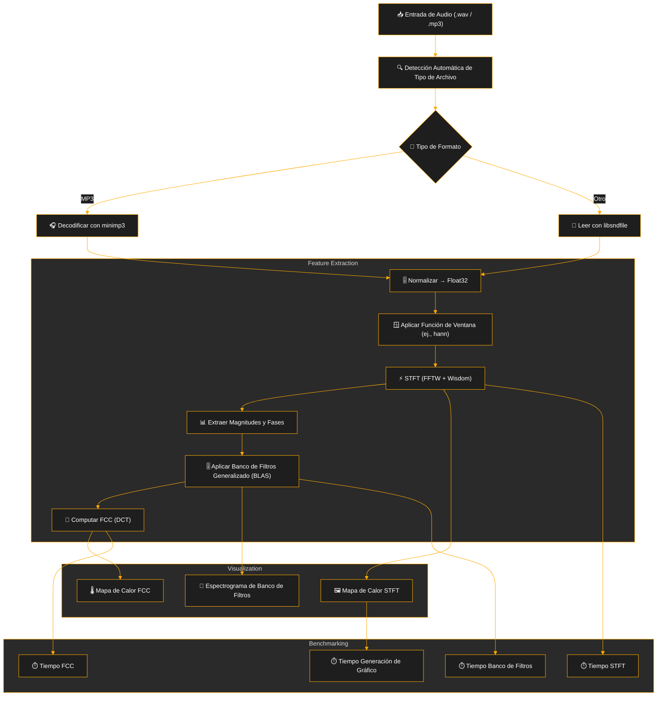
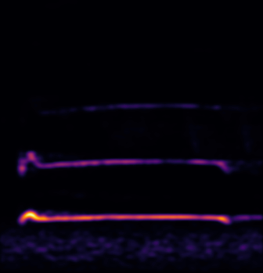
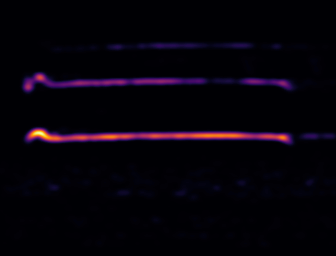
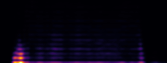
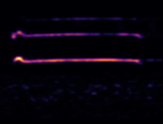
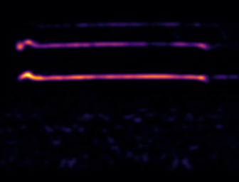
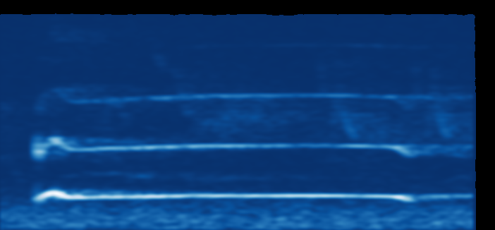
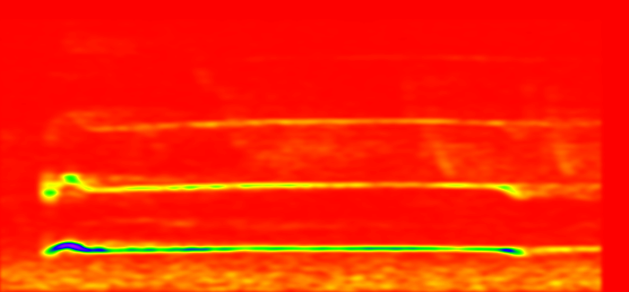

# 🎧 CARA (C Acoustic Representation & Analysis): Pipeline de Visualización y Procesamiento de Señales de Audio de Alto Rendimiento

**CARA** es una biblioteca de C de alto rendimiento para el procesamiento y visualización de señales de audio, que incluye la Transformada de Fourier de Tiempo Corto (STFT), espectrogramas Mel, Coeficientes Cepstrales de Frecuencia Mel (MFCC) y visualizaciones de mapas de calor de grado profesional. Optimizado para conjuntos de datos de audio a gran escala, aprovecha [FFTW](http://www.fftw.org/) con almacenamiento de sabiduría (wisdom caching), paralelización con [OpenMP](https://www.openmp.org/) y BLAS ([OpenBLAS](https://www.openblas.net/)) para operaciones matriciales rápidas. La biblioteca soporta múltiples formatos de audio (WAV, FLAC, MP3) a través de [libsndfile](https://libsndfile.github.io/libsndfile/) y [minimp3](https://github.com/lieff/minimp3), y ofrece visualizaciones personalizables con esquemas de color extensos.


## ✨ Características Principales

- 🎧 **E/S de Audio con Detección de Formato**  
  Detección automática de formato y lectura de WAV, AAC, MP3 y más.  
  Los archivos MP3 se decodifican mediante [minimp3](https://github.com/lieff/minimp3) embebido; otros formatos utilizan [libsndfile](https://libsndfile.github.io/libsndfile/).

- 📊 **Transformada de Fourier de Tiempo Corto (STFT) Optimizada**  
  Utiliza FFTW con sabiduría almacenada para un rendimiento óptimo de la FFT.  
  Soporta múltiples funciones de ventana (Hann, Hamming, Blackman, Blackman-Harris, Bartlett, Flat-top, Gaussian, Kaiser).  
  Ejecución inteligente de hilo único/múltiples hilos con planes de FFTW por hilo.

- 🔊 **Procesamiento de Banco de Filtros Generalizado**  
  Soporta **6 escalas de frecuencia perceptuales y matemáticas**:
  - `F_MEL` – Escala Mel (perceptual)
  - `F_BARK` – Escala Bark (bandas críticas)  
  - `F_ERB` – Ancho de Banda Rectangular Equivalente
  - `F_CHIRP` – Escala logarítmica basada en chirp
  - `F_CAM` – Escala de tasa ERB de Cambridge
  - `F_LOG10` – Espaciado logarítmico en base 10
  
  Construido mediante `gen_filterbank()` con construcción de filtros triangulares, acelerado con operaciones matriciales BLAS (`cblas_sgemm`).

- 🧠 **Coeficientes Cepstrales de Frecuencia (FCC)**  
  Análisis cepstral generalizado utilizando coeficientes DCT precomputados.  
  Altamente optimizado con operaciones BLAS y paralelización OpenMP.  
  Soporta conteos de coeficientes personalizables y visualización.

- 🖼️ **Motor de Visualización Profesional**  
  Renderiza STFTs, espectrogramas de banco de filtros y FCCs como mapas de calor PNG de alta resolución.  
  Cuenta con **más de 130 variantes de mapas de colores**, incluyendo esquemas científicos y estilo OpenCV.  
  Inversión automática del eje de frecuencia para una visualización intuitiva de baja a alta frecuencia.

- ⏱️ **Benchmarking Exhaustivo**  
  Medición de tiempo con precisión de microsegundos para todas las etapas de procesamiento.  
  Análisis detallado de eficiencia paralela y mediciones de GFLOP/s.  
  Optimización del rendimiento multihilo con balanceo de carga automático.


- 🖼️ **Visualización**  
  Renderiza STFTs, espectrogramas de banco de filtros y MFCCs como mapas de calor PNG de alta resolución utilizando [libheatmap](https://github.com/lucasb-eyer/libheatmap).  
  Incluye **más de 130 variantes de mapas de colores**:
  - 🎨 22 mapas de colores estilo OpenCV  
  - 🌈 108 mapas de colores científicos (27 base × 4 variantes: discretos, suaves, mixtos, mixtos_exp)

- ⏱️ **Benchmarking**  
  Medición de tiempo con resolución de microsegundos para STFT, aplicación de banco de filtros, MFCC y trazado.  
  Incluye gráficos de barras codificados por colores y clasificados, y genera registros tanto en formato raw como JSON para un análisis más profundo.

- ⚙️ **Optimizaciones de Rendimiento**  
  Paralelismo OpenMP, sabiduría de FFTW, operaciones matriciales BLAS y optimizaciones agresivas del compilador, incluyendo Optimización en Tiempo de Enlace (LTO), generación de código nativo de CPU y transformaciones avanzadas de bucles.

- 🐦 **Aplicaciones**  
  Ideal para:
  - Bioacústica (ej., análisis de cantos de aves — `tests/files/black_woodpecker.wav`, `tests/files/173.mp3`)
  - Extracción de características para aprendizaje automático (ML)  
  - Pipelines de audio por lotes  
  - Investigación de procesamiento digital de señales (DSP)

## 💡 Motivación

La principal motivación detrás de este proyecto fue obtener una comprensión más profunda tanto de **C** como del **procesamiento digital de señales (DSP)**. Si bien existen innumerables tutoriales sobre cómo **usar** MFCCs y bancos de filtros Mel, muy pocos explican realmente cómo **computarlos** desde cero. El proceso a menudo estaba fragmentado o oculto detrás de llamadas a bibliotecas.

Al buscar pipelines de MFCC minimalistas, encontré proyectos excelentes como [rust-mfcc](https://github.com/bytesnake/mfcc), que tuvo un rendimiento impresionante — aproximadamente **2.5 veces más rápido que Librosa** en benchmarks sintéticos ([Cuaderno de Colab](https://github.com/8g6-new/mfcc_rust_bench/blob/master/rust_vs_python.ipynb)).  
Sin embargo, a menudo dependen de dependencias externas y abstracciones que ocultan lo que sucede internamente.

Noté una falta de **implementaciones en C simples, sin dependencias excesivas y bien estructuradas** de STFT, espectrogramas Mel y MFCCs que enfatizaran:

1. **Legibilidad** – Código que principiantes en C puedan seguir realmente  
2. **Valor Educativo** – Un pipeline de DSP paso a paso expuesto  
3. **Transparencia** – Cada transformación está escrita explícitamente (FFT, banco Mel, DCT)

A medida que construí este proyecto, llegué a comprender y apreciar:
- Cómo interactúan el **ventaneo (windowing)**, el **tamaño del salto (hop size)** y la **resolución de la FFT**  
- El funcionamiento interno de la **construcción del banco de filtros Mel**  
- Cómo derivar **MFCCs usando DCT**, y por qué los coeficientes son importantes  
- Las implicaciones de rendimiento del **diseño de memoria**, la **localidad de la caché** y el **acceso a memoria contigua**  
- Cómo pequeños detalles como el **anidamiento de bucles**, la **vectorización BLAS** y la **alineación de datos** pueden afectar drásticamente la velocidad

Este proyecto sirve tanto como una **referencia clara, hackeable y minimalista** para estudiantes, aficionados y cualquier persona que quiera aprender DSP construyéndolo desde cero, logrando al mismo tiempo un rendimiento competitivo con bibliotecas establecidas.

Si ayuda a otros a desmitificar el pipeline de DSP o a escribir el suyo propio desde cero, entonces habrá cumplido su propósito.

## Descripción General del Pipeline




## Requisitos

- **Compilador**: GCC o Clang con soporte para C11.
- **Dependencias**:
  - **FFTW3** ([FFTW](http://www.fftw.org/)) para transformadas rápidas de Fourier.
  - **libsndfile** ([libsndfile](https://libsndfile.github.io/libsndfile/)) para el manejo de archivos WAV/FLAC.
  - **OpenMP** ([OpenMP](https://www.openmp.org/)) para procesamiento paralelo.
  - **BLAS** (ej., [OpenBLAS](https://www.openblas.net/)) para operaciones matriciales.
  - **libpng** ([libpng](http://www.libpng.org/pub/png/libpng.html)) para salida PNG.

## Instalación

### Paso 1: Instalar Dependencias

**Instalación Automatizada:**
```bash
git clone --depth 1 https://github.com/8g6-new/CARA && cd CARA
make install  # Ejecuta install_libs.sh para sistemas Ubuntu/Debian
```

**Instalación Manual (Ubuntu/Debian):**
```bash
sudo apt-get update
sudo apt-get install libfftw3-dev libsndfile1-dev libopenblas-dev libpng-dev libomp-dev
```

### Paso 2: Construir el Proyecto

Elija un objetivo de construcción:
```bash
# Esquemas de colores científicos integrados (108 variantes)
make builtin

# Esquemas de colores similares a OpenCV (22 variantes)  
make opencv_like

# Construcciones de depuración con sanitizadores
make debug_builtin
make debug_opencv_like
```

La construcción crea los ejecutables y genera archivos de sabiduría de FFTW en `cache/FFT/`.

## Uso

### Inicio Rápido

**Procesar todos los archivos de prueba con la configuración predeterminada:**
```bash
make run
```

**Ejecutar validación exhaustiva de parámetros (N combinaciones aleatorias):**
```bash
make test_all N=50
```

### Interfaz de Línea de Comandos (CLI)

La nueva CLI soporta un análisis de argumentos moderno:

```bash
./builtin -i input.wav -o output_prefix -ws 2048 -hop 128 -wf hann \
          -nm 256 -nfcc 64 -stft_cs 4 -fb_cs 6 -fcc_cs 17 \
          -fb mel -c ./cache/FFT -t 4
```

**Parámetros Clave:**
- `-i`: Ruta del archivo de audio de entrada
- `-o`: Prefijo de salida para los archivos PNG  
- `-ws`: Tamaño de ventana de la STFT (512, 1024, 2048, 4096)
- `-hop`: Tamaño del salto (hop size) para la STFT
- `-wf`: Función de ventana (`hann`, `hamming`, `blackman`)
- `-nm`: Número de filtros (32, 64, 128, 256)
- `-nfcc`: Número de coeficientes cepstrales (12, 24, 64, 128)
- `-fb`: Tipo de banco de filtros (`mel`, `bark`, `erb`, `log10`, `chirp`, `cam`)
- `-stft_cs`, `-fb_cs`, `-fcc_cs`: Índices del esquema de colores
- `-c`: Directorio de caché para los archivos de sabiduría de FFTW
- `-t`: Número de hilos para OpenMP

### Uso Programático

```c
#include "audio_tools/audio_visualizer.h"
#include "utils/bench.h"

int main() {
    const char *input_file = "input.wav";
    const char *output_base = "output";

    // ------------------ Audio ------------------
    audio_data audio = auto_detect(input_file);
    const size_t window_size = 2048;
    const size_t hop_size    = 128;
    const size_t num_mel_filters = 256;
    const size_t num_mfcc_coeffs = 64;

    // ------------------ Ventana & FFT ------------------
    START_TIMING();
    float *window_values = malloc(window_size * sizeof(float));
    window_function(window_values, window_size, "hann");
    END_TIMING("win");

    START_TIMING();
    fft_t fft_plan = init_fftw_plan(window_size, "cache/FFT");
    END_TIMING("fft_plan");

    // ------------------ STFT ------------------
    plot_t settings = {.cs_enum = Viridis, .db = true, .bg_color = {0,0,0,255}};

    START_TIMING();
    stft_t result = stft(&audio, window_size, hop_size, window_values, &fft_plan);
    END_TIMING("stft");

    print_stft_bench(&result.benchmark);

    // ------------------ Límites y Copia ------------------
    bounds2d_t bounds = {0};
    bounds.freq.start_f = 0;
    bounds.freq.end_f   = result.num_frequencies;
    set_limits(&bounds, result.num_frequencies, result.output_size);
    init_bounds(&bounds, &result);

    const size_t t_len = bounds.time.end_d - bounds.time.start_d;
    const size_t f_len = bounds.freq.end_d - bounds.freq.start_d;
    float *cont_mem = malloc(t_len * f_len * sizeof(float));

    START_TIMING();
    fast_copy(cont_mem, result.magnitudes, &bounds, result.num_frequencies);
    END_TIMING("copy");

    sprintf(settings.output_file, "%s_stft.png", output_base);
    settings.w = t_len;
    settings.h = f_len;

    START_TIMING();
    plot(cont_mem, &bounds, &settings);
    END_TIMING("plot:stft");

    // ------------------ Mel ------------------
    float *filterbank = calloc((result.num_frequencies + 1) * (num_mel_filters + 2), sizeof(float));
    filter_bank_t bank = gen_filterbank(F_MEL, 20.0f, 8000.0f, num_mel_filters,
                                        audio.sample_rate, window_size, filterbank);

    START_TIMING();
    float *mel_values = apply_filter_bank(cont_mem, num_mel_filters, result.num_frequencies, filterbank, &bounds);
    END_TIMING("mel");

    sprintf(settings.output_file, "%s_mel.png", output_base);
    settings.h = num_mel_filters;
    settings.w = t_len;

    START_TIMING();
    plot(mel_values, &bounds, &settings);
    END_TIMING("plot:mel");

    // ------------------ MFCC ------------------
    dct_t dft_coff = gen_cosine_coeffs(num_mel_filters, num_mfcc_coeffs);

    START_TIMING();
    float *fcc_values = FCC(mel_values, &dft_coff, &bounds, &settings);
    END_TIMING("mfcc");

    sprintf(settings.output_file, "%s_mfcc.png", output_base);
    settings.h = dft_coff.num_coff;
    settings.w = t_len;

    START_TIMING();
    plot(fcc_values, &bounds, &settings);
    END_TIMING("plot:mfcc");

    // ------------------ Limpieza ------------------
    free_stft(&result);
    free_audio(&audio);
    free(window_values);
    free_fft_plan(&fft_plan);
    free(cont_mem);
    free(mel_values);
    free(fcc_values);
    free(filterbank);
    free(bank.freq_indexs);
    free(bank.weights);
    free(dft_coff.coeffs);

    print_bench_ranked();

    return 0;
}
```

## 📊 Visualizaciones

### Ejemplos de Banco de Filtros y FCC

Visualizaciones utilizando **FFT de 2048 puntos**, **tamaño de salto de 128 muestras**, mapa de colores **Inferno**:

| Tipo de Salida | Descripción | Vista Previa |
|----------------|-------------|--------------|
| **Espectrograma STFT** | Magnitudes brutas de la Transformada de Fourier de Tiempo Corto |  |
| **Banco de Filtros Mel** | Espectrograma de escala Mel con 256 filtros |  |
| **MFCC** | 128 Coeficientes Cepstrales de Frecuencia Mel |  |
| **Banco de Filtros Bark** | Espectrograma de filtro en escala Bark |  |
| **Banco de Filtros ERB** | Filtro de Ancho de Banda Rectangular Equivalente |  |

### Ejemplos de Esquemas de Color

| Objetivo de Construcción | Mapa de Colores | Vista Previa |
|--------------------------|----------------|--------------|
| **Built-in** | Blues (Soft) |  |
| **OpenCV-like** | Rainbow |  |

**Referencia de Esquemas de Color:** Todos los más de 130 mapas de colores soportados están documentados en `outputs/colors.json` con sus mapeos a los IDs de enumeración internos.

## Estructura del Proyecto

```
.
├── cache/FFT/              # Archivos de sabiduría de FFTW para planes de FFT optimizados
├── headers/                # Archivos de encabezado para herramientas de audio y utilidades
├── outputs/                # Espectrogramas y visualizaciones generadas
├── src/                    # Código fuente
│   ├── libheatmap/         # Visualización de mapas de calor con esquemas de colores
│   ├── png_tools/          # Utilidades de salida PNG
│   ├── utils/              # Funciones de benchmarking y utilidades
│   └── audio_tools/        # E/S de audio, computación de STFT, Mel y MFCC
├── tests/files/            # Archivos de audio de prueba
├── main.c                  # Programa CLI principal
├── Makefile                # Configuración de construcción con banderas de optimización
└── README.md               # Esta documentación
```

## Trabajo Futuro

- **Soporte SIMD Explícito**: Implementar optimizaciones SIMD explícitas (SSE, AVX) más allá de la autovectorización del compilador.
- **Aceleración por GPU**: Implementaciones basadas en CUDA utilizando cuFFT y cuBLAS.
- **Procesamiento en Tiempo Real**: Soporte para análisis de audio en streaming.
- **Optimización de Memoria**: Asignadores de pool (pool allocators) y gestión de memoria basada en arenas.

## 📄 Licencia

Licenciado bajo la [Licencia MIT](./LICENSE). Eres libre de usar, modificar y distribuir el código, incluyendo para fines comerciales, con la atribución adecuada.

## Agradecimientos

- Inspirado por [Librosa](https://librosa.org/) para el procesamiento de audio de alto rendimiento.
- Construido con [FFTW](http://www.fftw.org/), [libsndfile](https://libsndfile.github.io/libsndfile/), [OpenBLAS](https://www.openblas.net/), [libpng](http://www.libpng.org/pub/png/libpng.html) y [OpenMP](https://www.openmp.org/).
- Visualización a través de [lucasb-eyer/libheatmap](https://github.com/lucasb-eyer/libheatmap).
- Decodificación de MP3 por [lieff/minimp3](https://github.com/lieff/minimp3).
